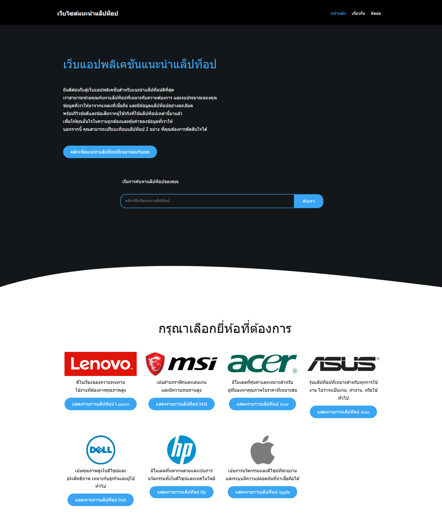

# 💻 Laptop Recommendation Web Application

เว็บแอปพลิเคชันสำหรับแนะนำแล็ปท็อปด้วยแนวคิด **Rule-based Expert System**
พัฒนาขึ้นเพื่อช่วยสนับสนุนการตัดสินใจเลือกซื้อแล็ปท็อปให้เหมาะสมกับความต้องการของผู้ใช้ โดยระบบจะวิเคราะห์จากข้อมูลที่ผู้ใช้ระบุ เช่น งบประมาณ รูปแบบการใช้งาน ระบบปฏิบัติการ และความต้องการด้านหน้าจอสัมผัส

จากข้อมูลดังกล่าว ระบบจะนำไปประมวลผลด้วยกฎการตัดสินใจ (Rules) ที่กำหนดไว้ และแสดงผลลัพธ์เป็นรายการแล็ปท็อปที่มีความเหมาะสมกับเงื่อนไขของผู้ใช้มากที่สุด

---

## 📸 Application Preview

ภาพหน้าหลักของระบบ



ดูรายละเอียดหน้าจอทั้งหมดได้ที่

➡️ [UI Documentation](docs/UI.md)

---

# ✨ Features

## 🤖 Laptop Recommendation System

ระบบแนะนำแล็ปท็อปแบบ Rule-based Expert System

ผู้ใช้ตอบคำถามเป็นขั้นตอน เช่น

- งบประมาณ
- รูปแบบการใช้งาน
- ระบบปฏิบัติการที่ต้องการ
- ความต้องการหน้าจอสัมผัส

จากนั้นระบบจะนำคำตอบไปตรวจสอบกับกฎทั้งหมด 18 ข้อ
และแสดงรายการแล็ปท็อปที่เหมาะสม

---

## 💻 Laptop Catalog

สามารถเลือกดูแล็ปท็อปตามแบรนด์ ได้แก่

- Acer
- Apple
- Asus
- Dell
- HP
- Lenovo
- MSI

พร้อมความสามารถ:

- ค้นหาจากชื่อรุ่น
- กรองข้อมูลแบบ Real-time
- เรียงลำดับราคาทันที

---

## 🔎 Real-time Filter & Sorting

ผู้ใช้สามารถกรองข้อมูลโดยไม่ต้องโหลดหน้าใหม่

รองรับการกรองตาม:

- แบรนด์
- ราคา
- RAM
  - 4 GB
  - 8 GB
  - 16 GB
  - 32 GB
- ความจุ Storage
  - 128 GB
  - 256 GB
  - 512 GB
  - 1 TB

ระบบจะกรองเฉพาะรายการที่กำลังแสดงอยู่

เช่น หากอยู่ในหน้าผลลัพธ์จากระบบแนะนำ
ตัวกรองจะทำงานเฉพาะกับผลลัพธ์นั้น

---

## 📄 Laptop Detail

หน้ารายละเอียดของแต่ละรุ่นประกอบด้วย

- รายละเอียดสเปก
- CPU
- GPU
- RAM
- Storage
- Display
- Connection
- ข้อดีและข้อเสีย
- ช่องทางการซื้อ

---

## ⚖️ Laptop Comparison

เปรียบเทียบแล็ปท็อป 2 รุ่นแบบเคียงข้างกัน

ช่วยให้ผู้ใช้ตัดสินใจเลือกซื้อได้ง่ายขึ้น

---

## 📩 Contact Form

มีแบบฟอร์มติดต่อผู้พัฒนา

รองรับการส่งอีเมลผ่าน EmailJS

---

# 🛠 Technology Stack

| ส่วน | เทคโนโลยี |
|---|---|
| Backend | Python 3.10+, Flask |
| Architecture | Application Factory + Blueprint |
| Database | MySQL 5.7+ / MariaDB |
| ORM / Database Access | SQLAlchemy + Parameterized SQL |
| Frontend | Jinja2 Template, HTML, CSS, jQuery |
| Configuration | python-dotenv |

---

# 📁 Project Structure

```
├── run.py
├── requirements.txt
├── .env.example

├── app/
│   ├── __init__.py
│   ├── config.py
│   ├── extensions.py
│   ├── models.py
│   ├── repository.py
│   │
│   └── routes/
│       ├── main.py
│       ├── catalog.py
│       └── recommendation.py

├── templates/
│   ├── base.html
│   ├── catalog_base.html
│   ├── brand_list.html
│   ├── recom_step.html
│   └── components/

├── database/
│   ├── schema.sql
│   └── example_seed.sql

└── static/
    ├── css/
    ├── js/
    └── images/
```

---

# 🏗 System Architecture

ระบบถูกออกแบบโดยแบ่งหน้าที่ออกเป็น 3 ส่วนหลัก

## 1. Routes Layer

ทำหน้าที่

- รับ Request จากผู้ใช้
- ตรวจสอบ Parameter
- เลือกข้อมูลที่ต้องใช้
- ส่งข้อมูลไปยัง Template

ใช้ Blueprint เพื่อแบ่งส่วนของระบบ เช่น

- หน้าเว็บไซต์หลัก
- ระบบ Catalog
- ระบบ Recommendation

---

## 2. Repository Layer

เป็น Data Access Layer สำหรับจัดการ Query ทั้งหมด

แทนที่ระบบเดิมที่มี Query ซ้ำจำนวนมาก
เปลี่ยนเป็นฟังก์ชันกลาง เช่น

```
fetch_summaries()
```

ซึ่งสามารถรองรับ

- ค้นหา
- กรอง
- เรียงราคา
- เลือกตามแบรนด์
- เลือกตาม Rule

พร้อมใช้ Parameterized SQL เพื่อเพิ่มความปลอดภัย

---

## 3. Template Layer

ใช้ Jinja2 Template Inheritance

โครงสร้างหลัก:

```
base.html
      |
catalog_base.html
      |
brand_list.html
```

ช่วยให้หน้าเว็บไซต์มีรูปแบบเดียวกัน และสามารถนำ Template กลับมาใช้งานร่วมกันได้

---

# 🧠 Rule-based Expert System

ระบบแนะนำถูกสร้างด้วยโครงสร้างคำถามแบบ Step-by-step

อยู่ในไฟล์

```
app/routes/recommendation.py
```

โดยใช้ตัวแปร

```
STEPS
```

สำหรับกำหนดเส้นทางของคำถาม

แต่ละตัวเลือกจะเชื่อมต่อไปยัง

- คำถามถัดไป
- หรือ Rule ที่ใช้ค้นหา Laptop

ตัวอย่าง:

```
User Answer
      ↓
Question Flow
      ↓
Rule Number
      ↓
Recommended Laptop
```

---

# 🚀 Installation

## 1. Clone Project

```bash
git clone https://github.com/MildRinrada/Web-Application-For-Laptops-Recommendation.git

cd Web-Application-For-Laptops-Recommendation
```

---

## 2. Create Virtual Environment

Windows:

```bash
python -m venv venv
venv\Scripts\activate
```

macOS/Linux:

```bash
python -m venv venv
source venv/bin/activate
```

---

## 3. Install Dependencies

```bash
pip install -r requirements.txt
```

---

# ⚙️ Configuration

สร้างไฟล์ `.env`

จากตัวอย่าง

```
.env.example
```

กำหนดค่า Database

```env
DB_HOST=localhost
DB_PORT=3306
DB_NAME=laptopdb
DB_USER=root
DB_PASSWORD=your_password

FLASK_DEBUG=1
```

---

# 🗄 Database Setup

สร้าง Database และ Table

```bash
mysql -u root -p < database/schema.sql
```

เพิ่มข้อมูลตัวอย่าง

```bash
mysql -u root -p laptopdb < database/example_seed.sql
```

ข้อมูลในไฟล์ Seed เป็นข้อมูลตัวอย่างสมมติ
จัดทำขึ้นเพื่อทดสอบระบบให้ครอบคลุม Rule 1–18

---

# ▶️ Run Application

```bash
python run.py
```

เปิดเว็บไซต์

```
http://127.0.0.1:5000
```

---

# 🔮 Future Improvements

- เพิ่มระบบ Admin สำหรับจัดการข้อมูล Laptop
- เพิ่มหน้าแก้ไข Rule ผ่าน UI
- เพิ่ม Pagination
- เพิ่ม Full-text Search
- เพิ่ม Unit Test / Integration Test
- Deploy ด้วย Docker + Gunicorn + Nginx
- ปรับ Responsive สำหรับ Mobile

---

# 🔒 Data Privacy

ข้อมูลแบบสอบถามจริงไม่ได้ถูกเผยแพร่ใน Repository นี้

Repository นี้ประกอบด้วยเฉพาะ

- Source Code
- Database Structure
- Example Seed Data

เพื่อรักษาความเป็นส่วนตัวของผู้ตอบแบบสอบถาม
