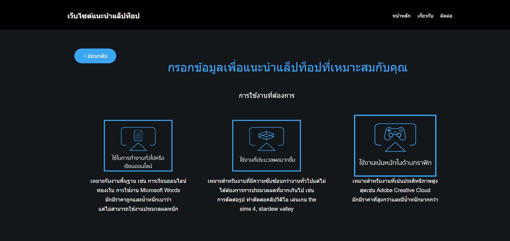
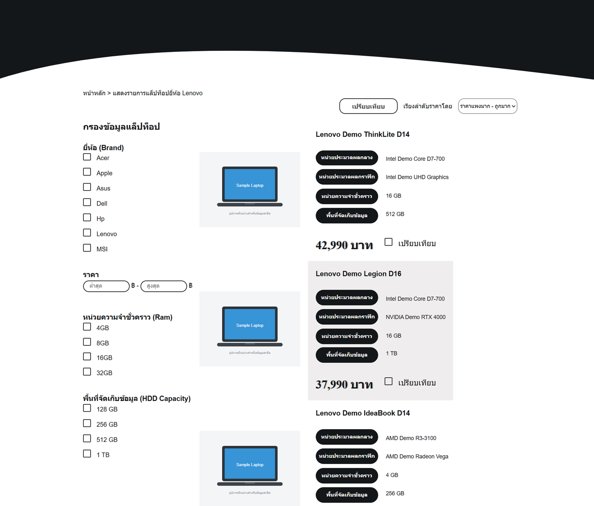
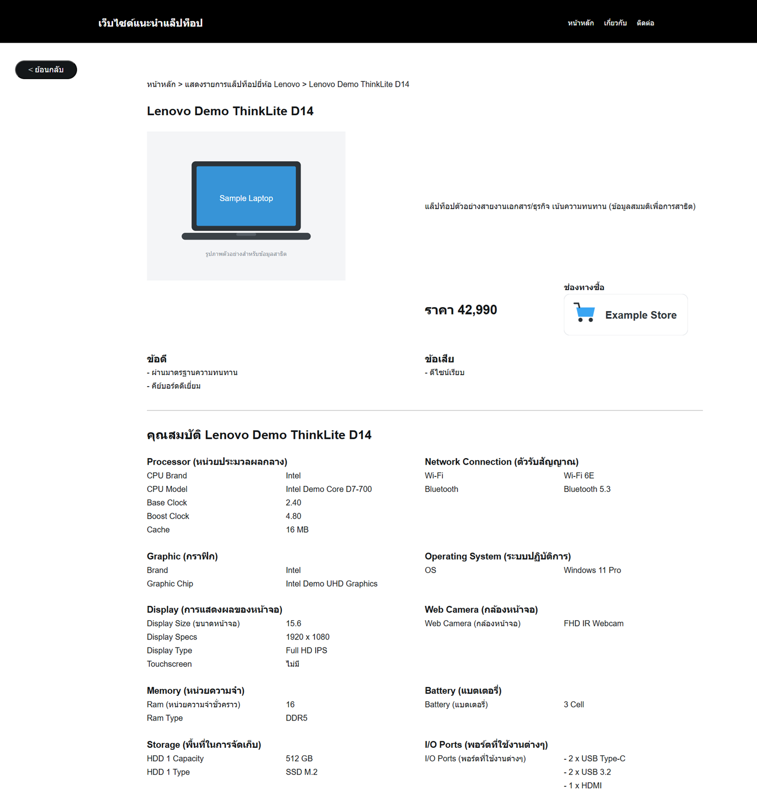
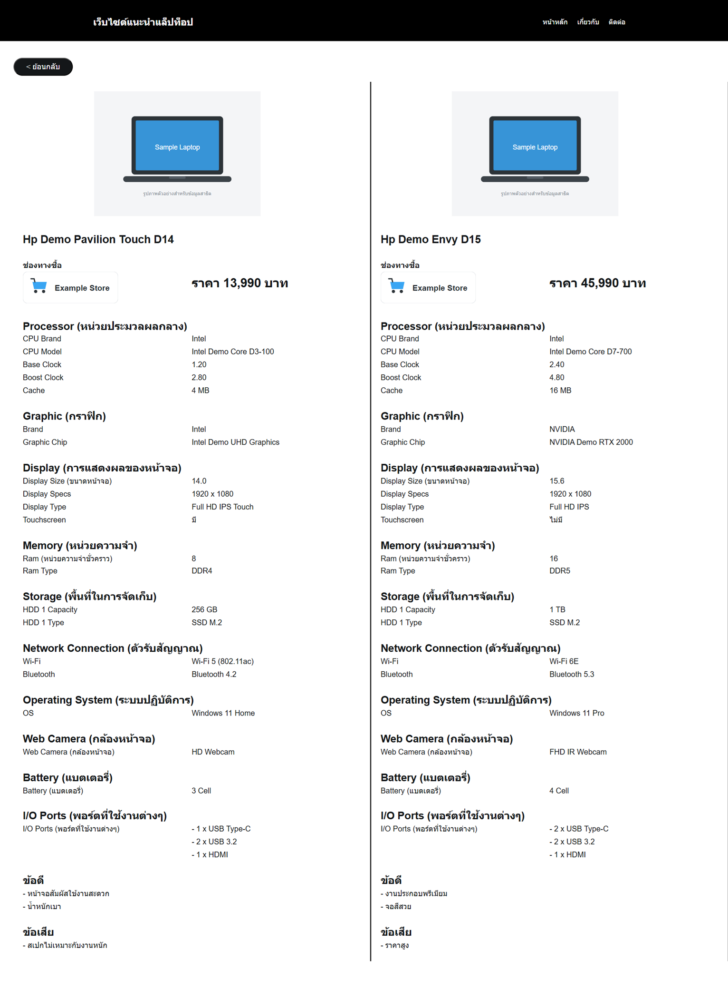

# 🖥 User Interface docsumentation

เอกสารแสดงหน้าตาและการใช้งานของระบบ Laptop Recommendation Web Application

---

# 1. Home Page


หน้าแรกของระบบ

ประกอบด้วย

- เมนูเข้าสู่ระบบแนะนำ Laptop
- เมนูเลือกดู Laptop ตามแบรนด์
- ช่องทางเข้าสู่หน้าค้นหา
- ส่วนแนะนำการใช้งานระบบ

เป็นจุดเริ่มต้นสำหรับผู้ใช้ก่อนเข้าสู่ระบบหลัก

---

# 2. Recommendation System



หน้าระบบแนะนำ Laptop

ผู้ใช้ตอบคำถามทีละขั้น เช่น

- งบประมาณ
- ลักษณะการใช้งาน
- ระบบปฏิบัติการ
- หน้าจอสัมผัส

ระบบจะประมวลผลจาก Rule-based Expert System
และแสดง Laptop ที่เหมาะสม

---

# 3. Laptop Catalog



หน้ารายการ Laptop

ผู้ใช้สามารถ

- เลือกดูตามแบรนด์
- ค้นหารุ่นที่ต้องการ
- กรองข้อมูล
- เรียงราคาจากต่ำไปสูงหรือสูงไปต่ำ

---

# 4. Laptop Detail



หน้าแสดงรายละเอียด Laptop

ข้อมูลประกอบด้วย

- รูปภาพ
- ราคา
- สเปก Hardware
- จุดเด่น
- ข้อจำกัด
- ช่องทางซื้อ

---

# 5. Laptop Comparison



หน้าเปรียบเทียบ Laptop

สามารถเลือก Laptop จำนวน 2 เครื่อง
เพื่อเปรียบเทียบข้อมูลแบบตาราง

ช่วยให้เห็นความแตกต่างของ

- CPU
- GPU
- RAM
- Storage
- Display
- ราคา

ได้ง่ายขึ้น

---

# User Flow

```
Home
 |
 |
Recommendation
 |
 |
Answer Questions
 |
 |
Recommended Laptop
 |
 +----------------+
 |                |
Detail        Compare
 |
Catalog
```

---

# Design Concept

UI ถูกออกแบบให้ใช้งานง่าย

แนวคิดหลัก:

- ลดจำนวนขั้นตอนในการเลือก Laptop
- แสดงข้อมูลสำคัญอย่างชัดเจน
- รองรับผู้ใช้ที่ไม่มีความรู้ด้าน Hardware
- ช่วยตัดสินใจเลือกซื้อผ่านระบบแนะนำ